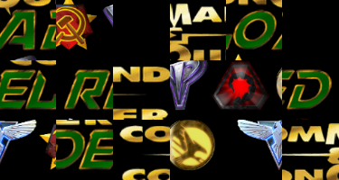
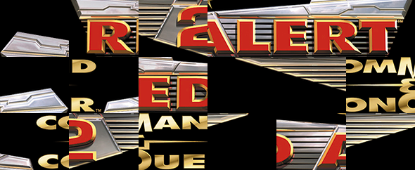
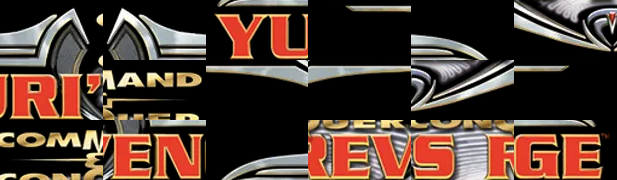
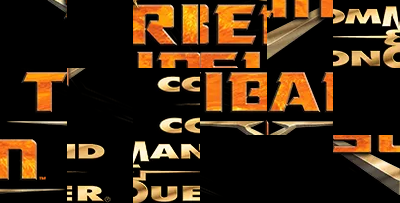
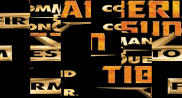

<p align="center">
  
</p>

<p align="center">
  
  
  
  
</p>

<p align="center">
  <sub>Campaigns from Red Alert 2, Yuri's Revenge, Tiberian Sun, and Firestorm.</sub>
</p>

# C&C Reloaded Randomizer Launcher

The Windows launcher supports optional in-place updates from GitHub Releases.
Declining an update suppresses its popup for that version; the corner Update
button remains available. See [launcher updates](UPDATING.md) for publishing,
APWorld installation, and recovery details.

[](https://github.com/Heinki/Reloaded-Randomizer/actions/workflows/security.yml)

A Windows campaign randomizer for C&C Reloaded 2.7.0 with standalone and
Archipelago 0.6.8 play. It creates deterministic mission and reward plans,
launches generated copies of campaign maps, tracks objectives and victories,
and applies earned unit access, buffs, powers, and enemy rewards.

The active factions are Allies, Soviets, Yuri, GDI, and Nod. CABAL units and
buildings are excluded from rewards and Shop stock, including Secret Lab
unlocks, until that faction is officially available.

## Disclaimer

This is an unofficial fan project. Its maintainer is not part of the C&C
Reloaded development team and did not contribute to C&C Reloaded. Credit for
the mod and its game content belongs to the C&C Reloaded developers and the
original Command & Conquer developers and publishers.

## Quick start

1. Make a separate, clean C&C Reloaded 2.7.0 installation. Do not use a copy
   containing map packs, rule edits, or other gameplay modifications.
2. Start that installation normally once and confirm that an original campaign
   mission launches.
3. Put `CnCReloadedRandomizer.exe` in the game folder beside
   `CnCReloadedClient.exe`, `Syringe.exe`, and `gamemd.exe`.
4. Run `CnCReloadedRandomizer.exe`.
5. Choose settings and select **Generate New Seed**.
6. Select an available mission and launch it through the Randomizer.
7. Complete objectives and win missions to earn rewards and progression.

For multiworld play, also download the matching `cnc_reloaded.apworld` and
follow the [C&C Reloaded Archipelago guide](Archipelago/README.md). Never mix a
launcher, APWorld, or Player YAML from different releases.

## Supported campaigns and modes

The launcher reads 108 missions from the installed `INI/Battle.ini`:

- Allies and Soviets in Red Alert 2
- Allies and Soviets in Yuri's Revenge
- GDI and Nod in Tiberian Sun
- GDI and Nod in Firestorm
- Yuri in Resurgence

Progression supports Classic, Mission List, Grid Mode, and Shop Mode. Reward
modes include Standard, Chaos, and Randomizer Arsenal. Advanced controls cover
unit access, buffs, powers, starting unlocks, enemy rewards, and mission
assistance.

Shop Mode is a deterministic roguelite. One **Shop run** is the complete
ten-stage session. A **stage** is one numbered step in that run, displayed as
`Stage 1 / 10`. A **mission** is one of the maps offered as a choice at that
stage. Each selected mission gets one attempt. An **Emergency Revival** keeps
the Shop run alive after a failed mission by repeating the same stage with new
mission choices.

Shop Mode uses all 108 reviewed Reloaded missions, approved units and defenses,
buffs, and 18 powers. Temporary mission cards can add one of 12 Reloaded player
boons or 7 Reloaded AI challenges; active power boons are not offered twice.

Current Run Shop shows unit and power offers together. Start New Run always
generates a fresh seed, and the rules dialog stays dismissed after confirmation.
Purchased buff stacks persist through mission victories and launcher reloads.
Blockbuster Special expires only purchased unit/power access at stage end;
its buffs remain available when the corresponding access is owned again.

Starter defenses cover ground and air targets; GDI uses Vulcan Cannon and SAM
Upgrade. Existing Shop runs with the old RPG Launcher AA starter are repaired
when resolving their loadout. Generated player units and defenses append
“Granted by Randomizer” to their native description through
[Phobos extended tooltips](https://phobos.readthedocs.io/en/stable/User-Interface.html#tooltips).
Private string-table labels are deployed only for the mission and cleaned up
with the launcher's other runtime assets.

Chemical Bomb (Tiberium Shower) is an offensive power. Shop access costs 10 Ore
or 50 Gems; upgrades start at 6 Ore or 12 Gems, matching other offensive powers.
It uses the chemical cameo for both access and upgrade cards. Its private payload
emits 8–12 crystal debris animations per bomb to reduce slowdown, including with
payload upgrades; the native chemical explosion remains active.

Permanent Shop progression spends Gems on unit access, unit buffs, all 18
reviewed superweapons and support powers, plus their 44 power buffs. Purchased
permanent powers activate automatically in future Shop runs; unit buffs follow
selected starting-loadout access.

Minor Secret Lab copies are consolidated into one native unit each: Desolator,
Chitzkoi, Cyborg, Terrorist, Yuri Clone, Tesla Tank and Repair Disk. Each has one
access offer, one upgrade list and one player production identity, using the
native unit's stats, tier and prices. Prior faction access is retained. Saved
unlocks and upgrade stacks migrate to the canonical unit; published Archipelago
item IDs remain readable for existing rooms. Distinct Secret Lab units remain
available as separate rewards.

MCVs share one set of buff stacks across factions. Harvesters share a separate
set, including the Slave Miner and Stealth Harvester. Amphibious transporters
share a third set, including the Landing Craft, Armored Transport and all three
Hover Transports. All five faction Engineers share a fourth set of buffs.
Current Loadout lists the four groups first with Open
Upgrades buttons, even before any buffs are owned. Both current and permanent
upgrade selectors show each group once. Each compatible variant keeps its
own base stats; weapon upgrades apply only to armed miners. Existing per-unit
Shop buff stacks are combined when saved profiles and runs load. The Stealth
Harvester still requires its own access unlock. The cloak upgrade also covers
the deployed Slave Miner and its workers. Worker stats remain native, and AI
miners keep their original workers. Earned cloak overrides a unit or building's
native cloak prohibition, including the multiplayer Stealth Generator and the
Mobile Stealth Generator's deployed form. Its deploy and undeploy links stay
within the upgraded player clone family.

Ammo upgrades apply only to finite ammunition. The Nod Harpy's effectively
unlimited ammo is excluded from upgrade offers; saved copies of its old ammo
reward are retired.

MCVs are available without buying an upgrade and require only a compatible war
factory, with no service depot or other support-tech prerequisites. Standard
uses each faction's factory; Chaos and Randomizer Arsenal share compatible
factories. MCV access also makes war factories available without other vehicle
unlocks. Their construction yards remain deploy targets. Player-built refineries
use private types that supply upgraded miners, including earned cloaking, even
before a war factory is built. Private refineries count toward refinery
prerequisites. Original and upgraded miners can unload at either original or
private player refineries, preserving each miner's compatible destinations.
When mission construction events or reviewed objectives require an exact native refinery
type, that refinery stays native and buildable. This preserves the Nod and GDI
Tiberian Sun opening objectives. Its free miner retains native stats; miners
built at factories still receive earned upgrades.
Native enemy refineries keep their original miners. Player miners revert to
their native type when captured by computer-controlled houses. Safe player miners
already placed in a mission receive the same upgrades, including ALL07_RA2's
starting Chrono Miners. Miners named by exact scripted type checks retain their
native identity to preserve those mission conditions. Relaunch a mission to
regenerate these rules; existing saves retain their previous map rules.

The first two Shop stages offer Standard mission choices, including a fixed-unit
or hero mission when available. From stage 3 onward, every remaining eligible
mission has equal selection probability, regardless of class or run length.
All three choices can be finales. Advanced mission exclusions apply to the
mixed-campaign Shop pool; excluding Resurgence leaves all 95 missions from the
other four campaigns available. Custom pools keep their unrestricted opening
choices. Completed missions only repeat when the selected pool is too small to
fill every stage's choices, or in Endless Mode. New standalone runs avoid up to
12 recent opening suggestions when enough alternatives are available. Advanced
and Shop use the same build and operation filters, and mission tooltips identify
the original campaign.

Each Shop mission card shows a deterministic difficulty for that choice. Early
stages favor Casual, middle stages favor Normal, and late stages can select
Hard. Mission Difficulty Assist lowers only its chosen mission by one step while
preserving the reward. Expanding the launcher log exposes a developer-only
mission-choice picker for recovery through normal Shop transitions.

**Enemy Powerhouses** is a single-stack enemy buff in Shop stage scaling and
the standalone/Archipelago enemy reward pool. It lets hostile AI bases build
faction heroes and special combat units. The full
five-faction pool includes Tanya, Boris, Chitzkoi, Yuri Prime, Ghost Stalker,
Umagon, both Nod commandos, the Mammoth Mk.II Prototype, Lunar Infantry,
evolved Brutes, and advanced faction infantry, vehicles, aircraft, and ships.
Each enemy house receives up to four seeded attack teams, with at most two
heroes and one living unit of each selected type. Selections vary by mission,
seed, and Shop stage. Units require a matching factory and existing active AI
production; fixed-force missions, protected scripted missions, and countries
shared with friendly actors are skipped. Enemy-buff settings control its
eligibility and cap.
Saved runs discard the retired Powerhouses run modifier when loaded.
Source maps and authored teams stay intact.

The Reloaded APWorld contains the approved reward catalogue, 108 missions, and
reserved locations for objectives, victories, and Shop Mode. Each Shop seed has 120 shuffled item
locations. Mission victories release up to 12 unchecked locations across failed
and restarted runs. Completing a Grid or Shop run reports the goal; the
Archipelago host's `release_mode` controls release of unfinished locations.
Local Grid reward-release settings never send unfinished Archipelago checks.

## Installation safety

Only original C&C Reloaded campaign maps are supported. Custom maps and other
gameplay modifications can redefine houses, units, weapons, triggers, and
mission scripts in ways the Randomizer has not audited.

The launcher never overwrites files under `Maps/Missions` or modifies the
game's MIX archives. It creates marker-owned `RLR_*.MAP` copies in the game
folder and verifies original map hashes before and after play. Persistent
settings, saves, logs, and caches are stored in `ReloadedRandomizerData`.

Generated Randomizer missions end after victory and return control to the
launcher. Authored campaign successors such as the second part of Vega's Dam
are selected and prepared separately instead of loading automatically.

Map-authored units, TaskForces, triggers, events, and actions keep their native
identities. Player production uses isolated Randomizer clones where necessary
to avoid changing enemy or scripted units that share the original type.

## AI-assisted development

This project was developed with assistance from OpenAI's ChatGPT and Codex.
AI tools have supported source analysis, implementation, refactoring,
debugging, and documentation. Generated work is reviewed and validated against
project requirements; final design and release decisions remain the
maintainer's responsibility.

## Documentation

Each maintained document has one purpose:

| Document                                                                       | Audience               | Content                                                                              |
| ------------------------------------------------------------------------------ | ---------------------- | ------------------------------------------------------------------------------------ |
| [Archipelago/README.md](Archipelago/README.md)                                 | Players and room hosts | APWorld installation, Player YAML export, room connection, play, and troubleshooting |
| [configs/README.md](configs/README.md)                                         | Maintainers            | Static mission, faction, reward, unit, Shop, and UI configuration                    |
| [Archipelago APWorld setup](Archipelago/APWorld/cnc_reloaded/docs/setup_en.md) | Archipelago clients    | Short package metadata and compatibility guide embedded in the APWorld               |

## Developer workflow

This project does not use tests or unit tests. Do not add or run test suites,
test harnesses, fixtures, automated gameplay simulations, or their dependencies,
scripts, CI jobs, and launcher entry points. This applies to every future task,
including requests to fix, build, release, validate, or check the project.
Use source inspection, compilation, actual builds, and the existing production
configuration/catalogue validators instead. Runtime validation and real mission
crash diagnostics remain part of the application. See [AGENTS.md](AGENTS.md).

Run from source with Python 3.14.6 from the fixed `Reloaded-Randomizer`
directory:

```powershell
python -m pip install -r requirements-build.txt
python launcher_gui.py
```

On Linux, create a virtual environment, install the runtime dependency, and
launch the same entry point. The launcher starts C&C Reloaded through Wine, so
both `wine` and `winepath` must be available on `PATH`.

```bash
cd Reloaded-Randomizer
python3 -m venv .venv
source .venv/bin/activate
python -m pip install -r requirements-runtime.txt
python launcher_gui.py
```

Validate changes from the `Reloaded-Randomizer` directory:

```powershell
python -m compileall -q randomizer Archipelago launcher_gui.py
python -c "from randomizer.config.static import REQUIRED_STATIC_CONFIGS, validate_static_configs; validate_static_configs(REQUIRED_STATIC_CONFIGS)"
python -m randomizer.audit
python -m Archipelago.audit
```

Build the launcher and matching APWorld on Windows:

```powershell
.\build_exe.ps1
```

The build script automatically selects an installed Python 3.14.6 even when
`python` on `PATH` points to an older version. Use `-PythonExecutable` with a
full path to override discovery.

On Linux, Wine and the pinned Windows Python 3.14.6 runtime at
`C:\Python3146` can build both normal release artifacts:

```bash
cd Reloaded-Randomizer
./build_all_linux.sh
```

Set `WINE_PYTHON` if Windows Python is installed elsewhere. The individual
commands are `./build_exe_wine.sh` and
`python3 Archipelago/build_apworld.py`. They still produce the Windows
`CnCReloadedRandomizer.exe`; there is no separate Linux executable format.
The combined build also refreshes the tracked APWorld and publishes a copy in
the game folder beside the EXE.

The build publishes `CnCReloadedRandomizer.exe` and
`cnc_reloaded.apworld` beside the repository in the game folder. PyInstaller
extracts the one-file runtime into the Windows temporary directory; a build or
runtime extraction directory is not part of the project.

## Source layout

| Path                      | Responsibility                                                            |
| ------------------------- | ------------------------------------------------------------------------- |
| `launcher_gui.py`         | Source and packaged entry point                                           |
| `randomizer/application/` | Application state, seed, progression, launch, and Archipelago controllers |
| `randomizer/config/`      | Static and player configuration loading and validation                    |
| `randomizer/core/`        | Paths, storage, diagnostics, and version primitives                       |
| `randomizer/maps/`        | Generated-map pipeline, ownership, clones, buffs, hooks, and settings     |
| `randomizer/missions/`    | Mission catalogue, policy, safety, and review evidence                    |
| `randomizer/progression/` | Mission List and Grid progression                                         |
| `randomizer/rewards/`     | Reward definitions, planning, and display                                 |
| `randomizer/shop/`        | Standalone and Archipelago Shop Mode                                      |
| `randomizer/ui/`          | Tk user interface                                                         |
| `Archipelago/`            | APWorld, embedded client, manifest, and YAML integration                  |
| `configs/`                | Reloaded-owned static JSON policy and ignored local player data           |
| `tools/`                  | Maintainer audits, data generation, and Windows packaging driver          |
| `build_exe_wine.sh`       | Windows PyInstaller build through Wine on Linux                           |
| `build_all_linux.sh`      | Combined Linux-side launcher and APWorld release build                    |

## Troubleshooting

Run this check first:

```powershell
.\CnCReloadedRandomizer.exe --self-check
```

The packaged report is written to
`ReloadedRandomizerData\self_check.json`. Launcher diagnostics are stored in
`ReloadedRandomizerData\logs\launcher.log`; objective and victory marker
activity comes from `debug\debug.log`.

When a launched mission closes without victory, the launcher saves a local
report under `ReloadedRandomizerData\mission_reports` before applying failure
progression and cleaning up launch files. It retains the five newest reports,
including the generated map, launch options, saved run/state, log tails, and
new or changed engine exception files. Each report is limited to 32 MiB;
individual files over 16 MiB are listed as skipped in `report.json`. An
incomplete mission report does not itself establish that the engine crashed.
Source launches store reports under `Reloaded-Randomizer/mission_reports`.

When reporting a problem, include those diagnostics, the mission code, seed,
reward and progression modes, and whether the issue also occurs in a fresh,
unmodified C&C Reloaded installation. Review `randomizer_state.json` before
sharing it because it contains seed and progress data.
